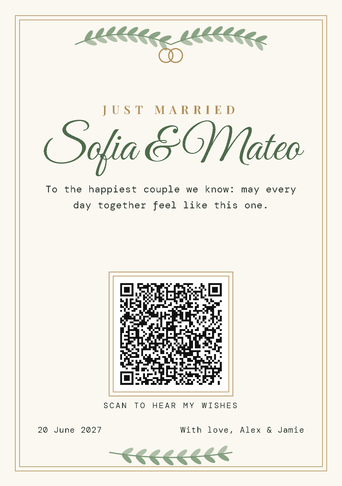
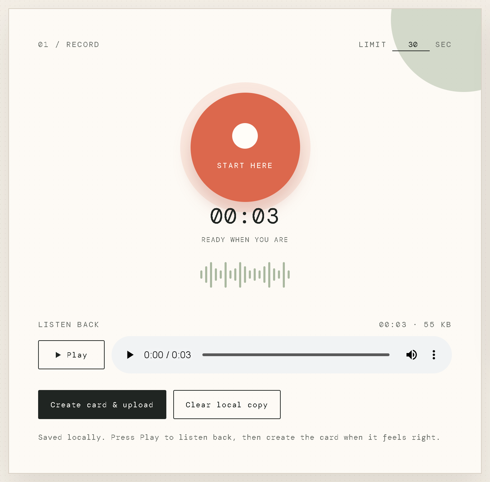
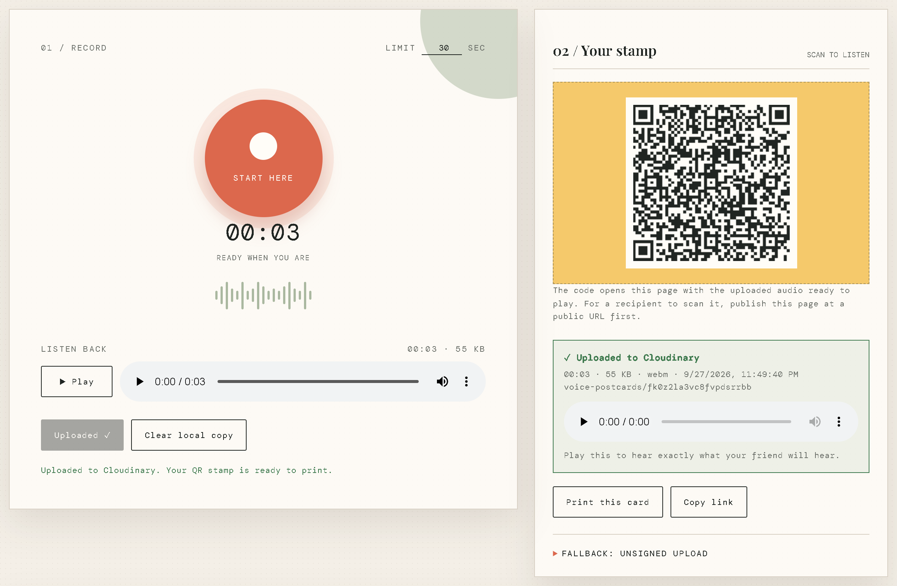
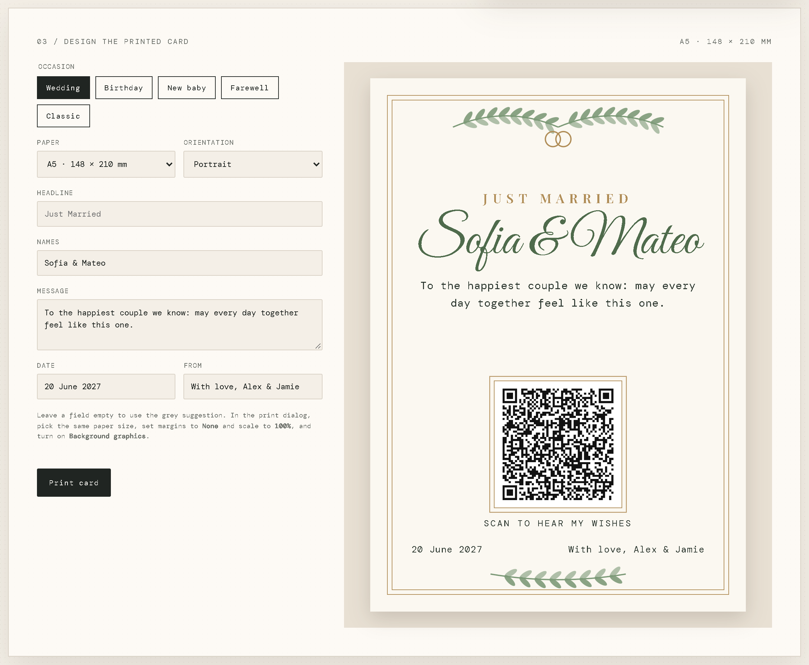
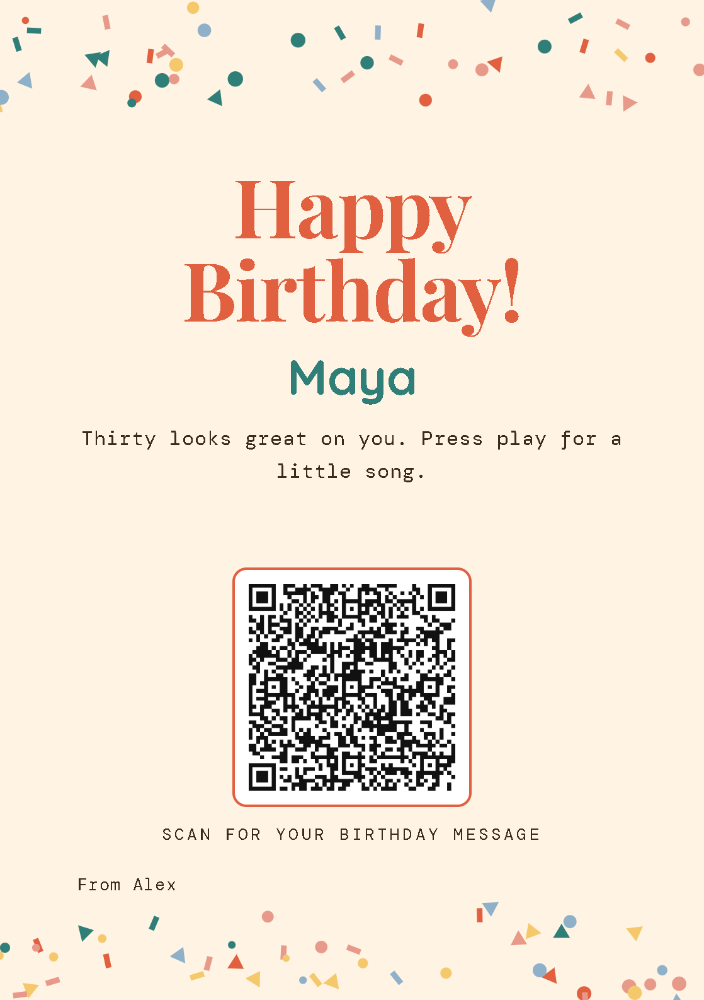
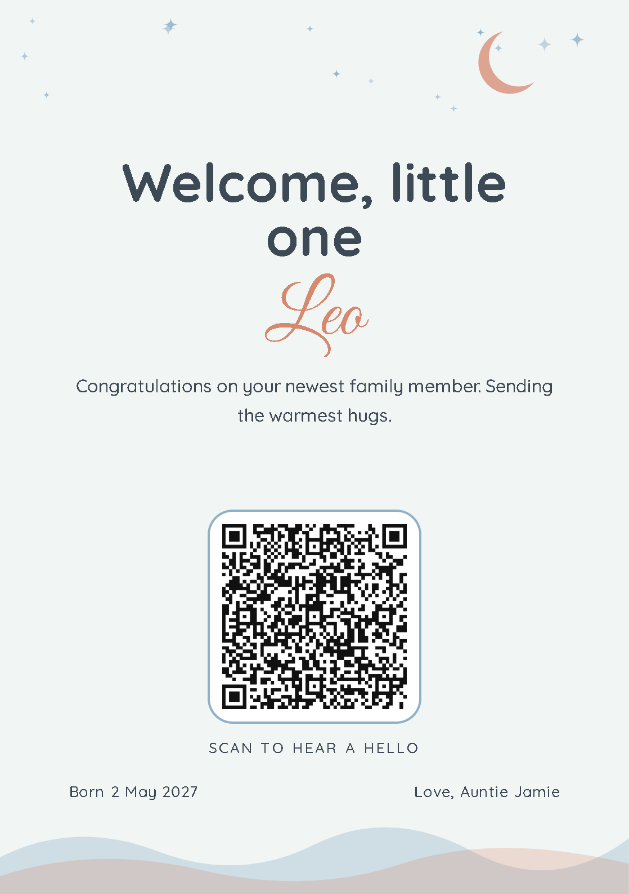
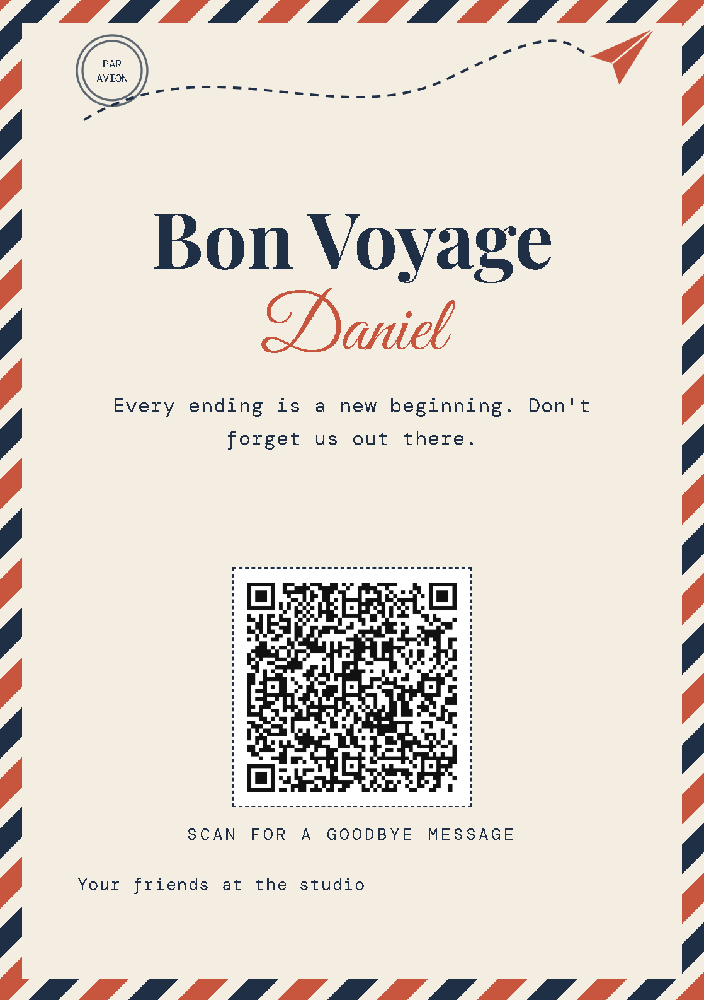
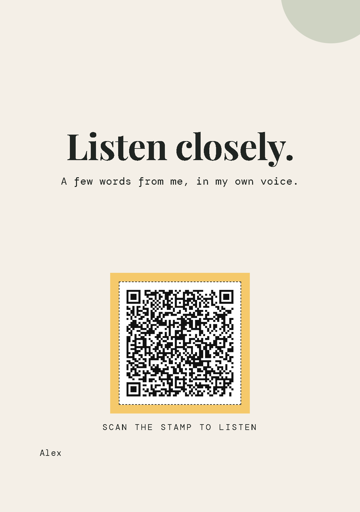

# Voice Postcard

Record a short voice message in the browser and print it as a card with a QR
code on it. Whoever scans the code hears your message. There are no accounts
for the recipient, no app to install, and no database.

<p align="center">
  
</p>

Card designs are included for **weddings, birthdays, new babies and
farewells**, plus a classic style. You can print on **A5** or **B5**, in
portrait or landscape.

---

## Contents

- [How it works](#how-it-works)
- [Prerequisites](#prerequisites)
- [Setup](#setup)
- [Walkthrough: a wedding card, step by step](#walkthrough-a-wedding-card-step-by-step)
- [Other occasions](#other-occasions)
- [Local development](#local-development)
- [Repository layout](#repository-layout)
- [Privacy and limits](#privacy-and-limits)
- [License](#license)

---

## How it works

```
 ┌───────────── your browser ──────────────────┐
 │ index.html (recorder mode)                  │
 │   1. record with the microphone             │
 │   2. keep a local copy in the browser       │
 │   3. POST /api/sign ───────────────┐        │
 │   4. upload clip to Cloudinary ◄───┘ signature
 │   5. print a card with a QR code for        │
 │      index.html?msg=<audio-url>             │
 └─────────────────────────────────────────────┘
                     │ print, mail, hand over
                     ▼
 ┌──────────── recipient's phone ──────────────┐
 │ index.html?msg=…  (player mode)             │
 │   plays the audio straight from Cloudinary  │
 └─────────────────────────────────────────────┘
```

- **One page, two modes.** Opened plain, `index.html` is the recorder and card
  designer. Opened with `?msg=<audio-url>`, it's a simple player. The QR code
  holds that second kind of link.
- **Cloudinary hosts the audio.** The browser uploads the clip directly to
  your Cloudinary account and gets back a public HTTPS link.
- **The only backend is one small function.** `api/sign.js` signs each
  upload with your Cloudinary API secret, so the secret never reaches the
  browser. It signs only a fixed folder (`voice-postcards/`) and a timestamp,
  and each signature expires after an hour.

---

## Prerequisites

| You need                    | Why                                              | Cost |
| --------------------------- | ------------------------------------------------ | ---- |
| A **Cloudinary** account    | Stores the recorded audio                        | Free plan |
| A **GitHub** account        | Holds your copy of this repo                     | Free |
| A **Vercel** account        | Hosts the page and the signing function          | Free (Hobby) |
| A browser with a microphone | Recording (recent Chrome, Edge, Firefox, Safari) | — |
| Node.js 18+ *(optional)*    | Only for running it locally                      | Free |

### Create your Cloudinary account first

Do this before anything else. The app has nowhere to store recordings
without it.

1. Sign up at <https://cloudinary.com/users/register_free>. The free plan
   needs no credit card.
2. Open the **Console**, then **Settings** (gear icon) → **API Keys**.
3. Note three values. You'll paste them into Vercel later:

   | Value          | Example           | Secret? |
   | -------------- | ----------------- | ------- |
   | **Cloud name** | `dxyz12abc`       | No      |
   | **API key**    | `123456789012345` | No      |
   | **API secret** | `aBcD…`           | **Yes. Never commit it or put it in `index.html`.** |

> Uploads go into a `voice-postcards/` folder in your Media Library, so they
> stay separate from anything else in the account.

---

## Setup

### 1. Get the code

Fork this repo on GitHub, or clone it and push it to your own repository:

```bash
git clone https://github.com/<you>/voice-postcard.git
cd voice-postcard
```

### 2. Deploy to Vercel

1. Go to <https://vercel.com/new> and import your repository.
2. **Framework Preset:** `Other`. Leave the build and output settings empty.
   There's no build step.
3. Open **Environment Variables** and add the three values from Cloudinary:

   ```
   CLOUDINARY_CLOUD_NAME=your-cloud-name
   CLOUDINARY_API_KEY=your-api-key
   CLOUDINARY_API_SECRET=your-api-secret
   ```
4. Click **Deploy**. Vercel serves `index.html` at `/` and `api/sign.js` at
   `/api/sign` automatically.
5. To check it worked, open your site, open the browser console, and run:

   ```js
   fetch('/api/sign', { method: 'POST' }).then(r => r.json()).then(console.log)
   ```

   If you see a `signature`, it's working. If you see *"Upload signing is not
   configured"*, the environment variables are missing, or you haven't
   redeployed since adding them.

> **Make printed cards from your production URL** (`https://<project>.vercel.app`
> or your own domain). The QR code holds whatever address you're on.
> Vercel's preview URLs sit behind a login, and `localhost` only works on
> your own computer.

<details>
<summary><b>Alternative: static hosting without Vercel (GitHub Pages, Netlify drop)</b></summary>

Static hosts can't run `api/sign.js`, so the page falls back to a Cloudinary
**unsigned upload preset**:

1. In Cloudinary, go to **Settings → Upload → Upload presets → Add upload
   preset**. Set **Signing Mode: Unsigned**, **Asset folder:**
   `voice-postcards`, **Allowed formats:** `webm, ogg, m4a, mp4, mp3, wav`,
   and **Max file size:** about 10 MB.
2. Publish the repo, for example through **Settings → Pages → main branch**.
3. On the site, expand **Fallback: unsigned upload** and enter your cloud name
   and preset name. They're saved only in that browser.

Anyone who learns an unsigned preset name can upload to your account with it.
Prefer Vercel if the site is public.
</details>

---

## Walkthrough: a wedding card, step by step

This example makes a card for the made-up couple **Sofia & Mateo**, from
**Alex & Jamie**.

### Step 1: Record your message

Open your deployed site and tap the orange **Start here** button. Speak, then
tap it again to stop. The **limit** field sets the maximum length (up to 2
minutes).

Under **Listen back**, press **▶ Play** to hear the recording before it goes
anywhere. It stays saved in your browser, so a page reload won't lose it.
Didn't like it? Just record again.

<p align="center"></p>

### Step 2: Upload it to Cloudinary

Tap **Create card & upload**. The button counts up to 100%. When Cloudinary
confirms the upload:

- the stamp box turns into a **QR code**,
- a green **✓ Uploaded to Cloudinary** box shows the length, size and file name,
- its player streams the **cloud copy**, exactly what the guests will hear.

<p align="center"></p>

If the upload fails, the error shows in red and the button becomes **Retry
upload**. No QR code is made until an upload succeeds, so you can't print a
card with a broken code.

### Step 3: Fill in the card

Scroll to **03 / Design the printed card** and fill it in:

| Field       | What we entered                                                               |
| ----------- | ----------------------------------------------------------------------------- |
| Occasion    | **Wedding**                                                                   |
| Paper       | **A5 · 148 × 210 mm** (B5 ISO and B5 JIS are also available)                  |
| Orientation | **Portrait**                                                                  |
| Headline    | *(left empty, so it uses the suggested "Just Married")*                       |
| Names       | `Sofia & Mateo`                                                               |
| Message     | `To the happiest couple we know: may every day together feel like this one.`  |
| Date        | `20 June 2027`                                                                |
| From        | `With love, Alex & Jamie`                                                     |

The preview on the right updates as you type. Any field you leave empty uses
the grey suggestion for that occasion. The page remembers what you entered.

<p align="center"></p>

### Step 4: Preview and print

This is exactly what prints, at real A5 size:

<p align="center"></p>

Tap **Print card**. In the print dialog:

| Setting                | Value                                           |
| ---------------------- | ----------------------------------------------- |
| Paper size             | Same as the card (**A5** here)                  |
| Margins                | **None**                                        |
| Scale                  | **100%** / *Actual size*                        |
| Background graphics    | **On** (otherwise colors and borders are lost)  |

Print on heavy cardstock (250–300 gsm) for a real-card feel. Most home
printers can't print to the very edge, so trim the card or use a print shop.

### Step 5: Give it away

Hand it over at the wedding or mail it. The couple scans the QR code with
their phone's camera, the page opens, and your message plays. No app needed.

Prefer tapping to scanning? Tap **Copy link** and write the link to an NFC
sticker (NFC Tools or a similar app) to put on the card.

---

## Other occasions

Every design works with every paper size and both orientations.

| Birthday | New baby | Farewell | Classic |
| :------: | :------: | :------: | :-----: |
|  |  |  |  |
| Confetti, bold headline | Moon, stars, soft colors | Airmail border, paper plane | The app's own stamp style |

---

## Local development

```bash
cp .env.example .env      # fill in your three Cloudinary values
npx vercel dev            # serves the page and /api/sign on http://localhost:3000
```

The microphone needs `localhost` or HTTPS. Cards made on `localhost` get a
warning, because their QR codes only work on your own computer.

---

## Repository layout

| Path           | What it is                                                            |
| -------------- | --------------------------------------------------------------------- |
| `index.html`   | The whole frontend: recorder, player, card designer, styles and script |
| `api/sign.js`  | Vercel serverless function that returns a Cloudinary upload signature  |
| `.env.example` | The environment variables `api/sign.js` needs                          |
| `img/`         | Screenshots used in this README                                        |
| `LICENSE`      | MIT                                                                    |

There's no build step and no dependencies. The only third-party code is
[qrcodejs](https://github.com/davidshimjs/qrcodejs) from cdnjs, plus Google
Fonts.

---

## Privacy and limits

- **Anyone with the link can play the message.** That includes anyone who
  finds the card. Don't record anything you wouldn't want a stranger to hear.
- **To take a message down**, delete the clip from your Cloudinary Media
  Library (`voice-postcards/` folder). The card then shows *"This message
  could not be loaded"*.
- **Don't change your site's address after printing.** Printed QR codes point
  to the domain they were made on. If you want a custom domain, set it up
  before you print.
- **Cloudinary's free plan has monthly usage limits.** They're plenty for
  personal cards. Check your dashboard if the site is public.
  `/api/sign` refuses requests from other websites.

---

## License

[MIT](LICENSE) © 2026 Rudy Ong
